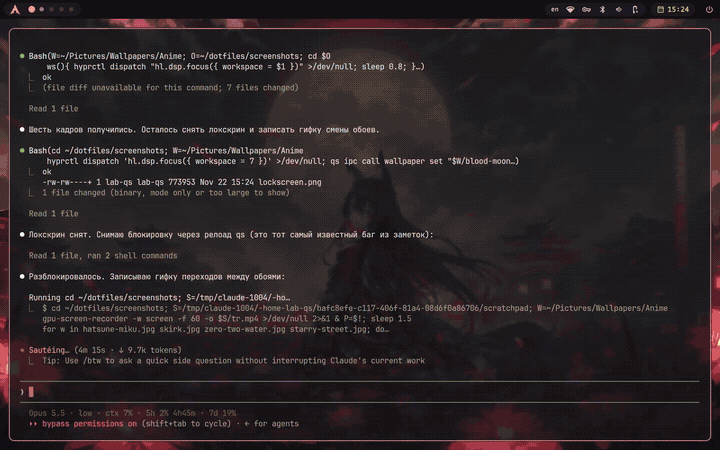
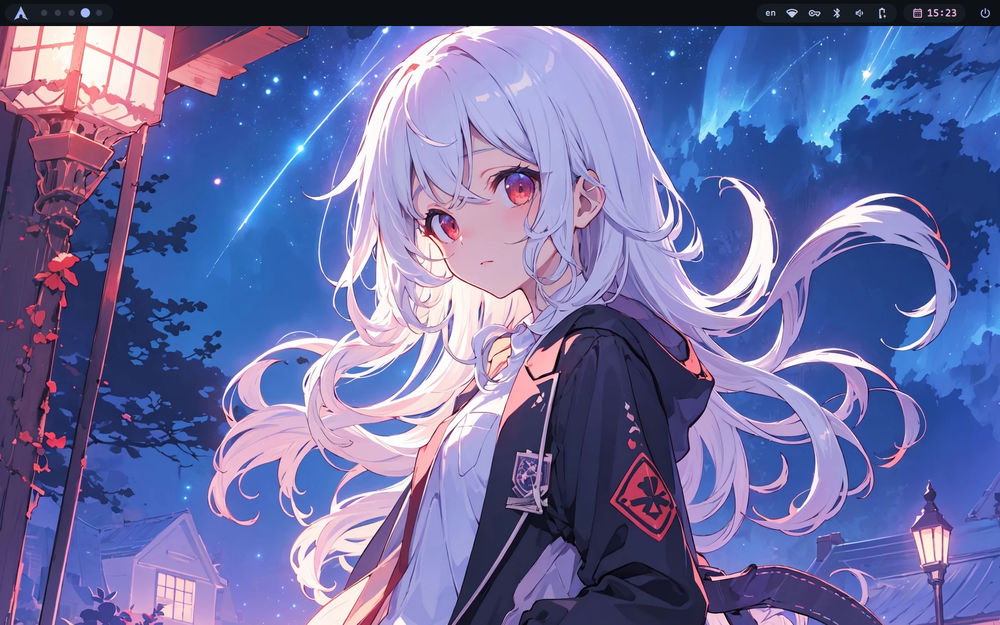
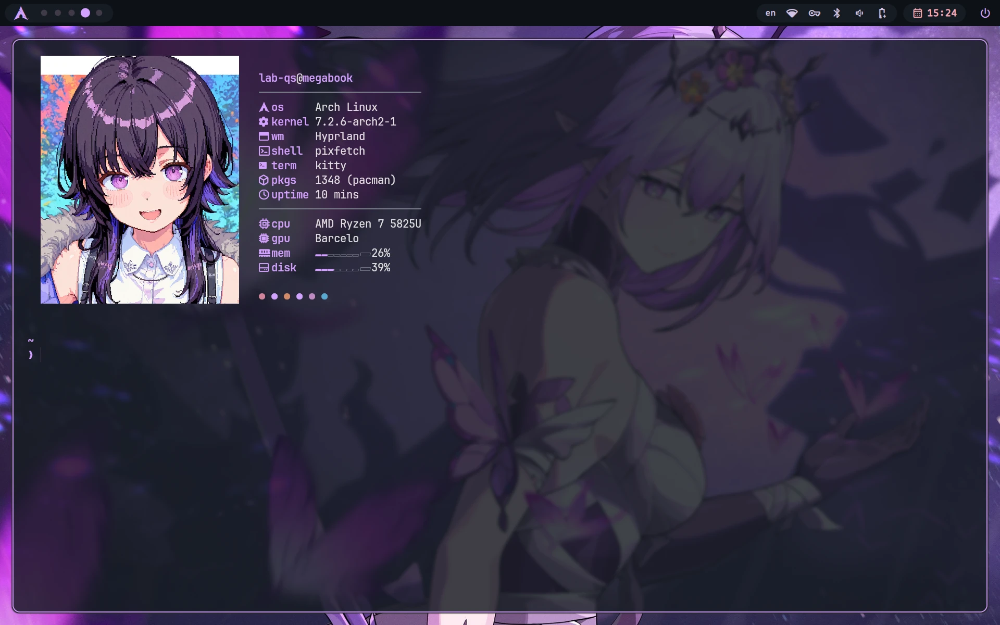
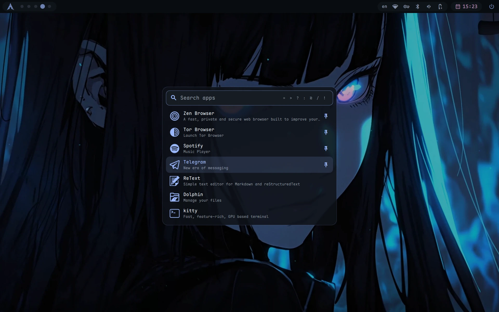
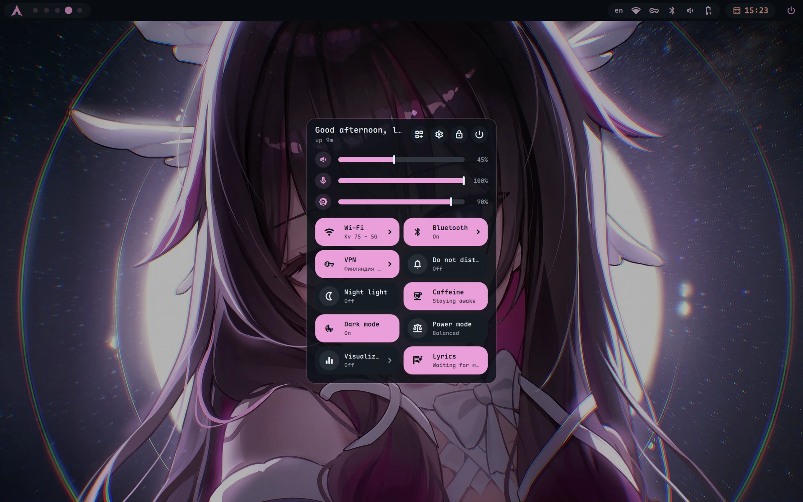
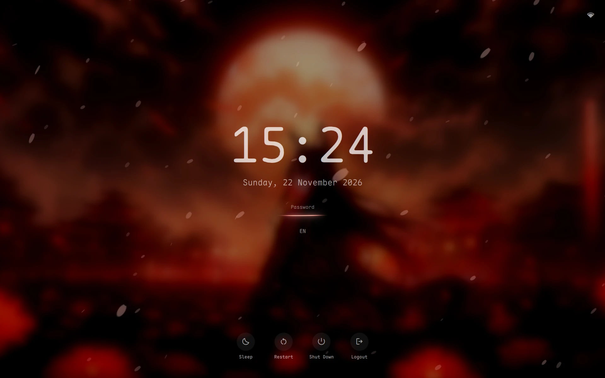
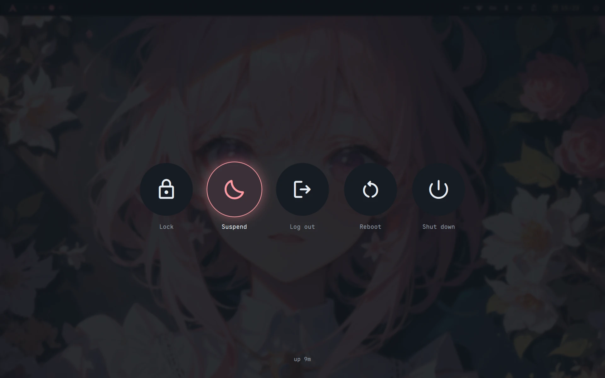
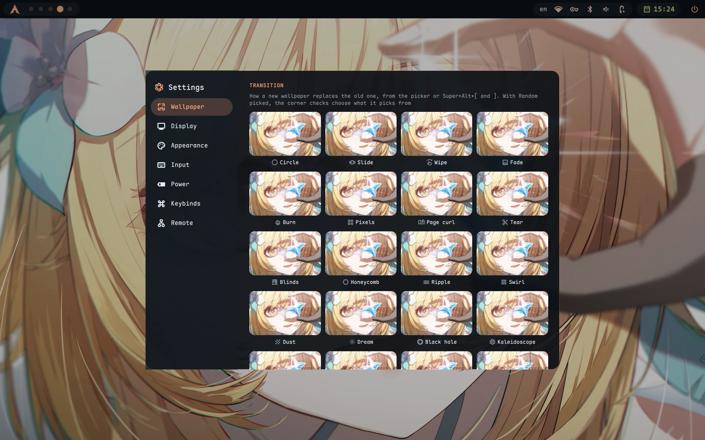
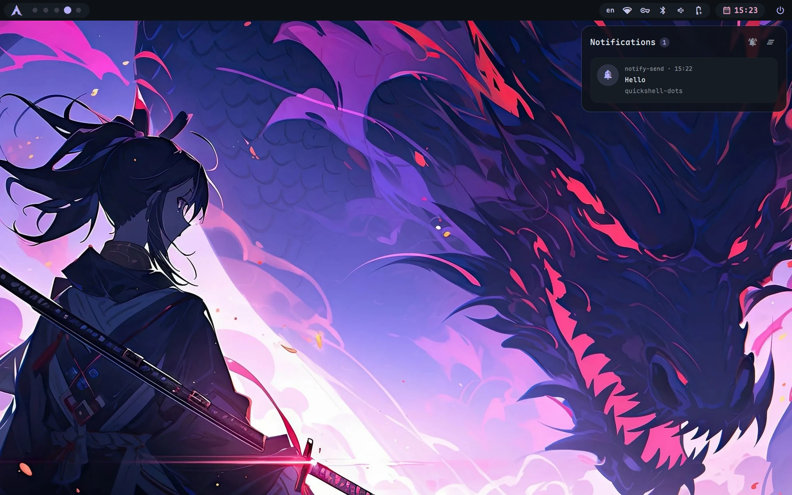

# quickshell-dots

A Hyprland desktop built around [Quickshell](https://quickshell.org): bar, launcher,
notifications, OSD, lockscreen and music effects are all one QML shell. The accent
colour follows the wallpaper and is pushed out to Hyprland borders, kitty, GTK and
Qt/KDE apps.



| | |
| --- | --- |
|  |  |
|  |  |
|  |  |
|  |  |

## What's inside

- **Bar** in pill groups: workspaces, audio visualizer, tray, clock, network,
  Bluetooth, battery, layout, screen recording indicator. Each pill opens a popout
  on hover.
- **Quick settings** card (`Super+I`): volume, mic and brightness sliders, Wi-Fi,
  Bluetooth, VPN, do not disturb, night light, caffeine, dark mode, power profile,
  visualizer and lyrics toggles.
- **Launcher** (`Super+R`): pinned apps you can drag to reorder, hiding and
  renaming apps, right-click menu.
- **Overview** (`Super+Tab`): windows spin around a ring.
- **Notifications**: toasts and a notification center that slides in from the
  right edge (`Super+N`).
- **OSD** for volume, brightness, mic, layout, Caps Lock and night mode. It stays
  quiet while a panel already shows the same level.
- **Lockscreen** over the blurred wallpaper with the playing track (`Super+L`).
- **Clipboard history** picker (`Super+V`), pastes into the focused window on Enter.
- **Wallpaper picker** (`Super+Shift+W`) for images and looping video wallpapers,
  switching with one of 28 shader transitions, from the screen edge or from the cursor:
  circle, slide, wipe, fade, burn, pixels, page curl, tear, blinds, honeycomb, ripple,
  swirl, dust, dream, black hole, kaleidoscope, RGB split, watercolor, speed lines,
  flip tiles, sakura, and glitches (glitch, signal, datamosh, pixel sort, corrupt,
  slices, CRT), or a random one.
- **Settings** window (`Super+,`): wallpaper transition with live previews, slideshow,
  resolution, refresh rate, scale and VRR (rolled back unless kept), night light
  warmth, panel scale, gaps, borders, rounding, blur, shadows, window and workspace
  animations, keyboard repeat, pointer, touchpad, cursor size, battery saver.
- **Music effects**: desktop visualizers, wallpaper effects driven by the beat,
  synced desktop lyrics with a karaoke glow on the sung word.
- **Light/dark scheme** toggle (`Super+Shift+D`), applied to GTK and Qt apps too.

## Layout

```
.config/hypr/         Hyprland (Lua config), hypridle, hyprlock, helper scripts
.config/quickshell/   the shell: shell.qml, modules/, services/, components/
.config/fastfetch/    fastfetch config
.config/kitty/        kitty, colours written by the shell into theme-colors.conf
.config/starship.toml prompt
.bashrc               starship and the fastfetch greeting
.local/bin/pixfetch   fastfetch with a random pixel-art logo
.local/bin/reddit-prep  re-encode a screen recording for a Reddit upload
.local/share/icons/   Suru++-Extra, extra app icons over Suru++ Asprómauros
```

## Requirements

Arch Linux is what it runs on; other distros should work with the same programs.

- Hyprland with Lua config support (0.56+), hypridle, hyprlock, hyprsunset,
  hyprpolkitagent, hyprpicker
- quickshell (`quickshell-git`)
- awww and mpvpaper for wallpapers, ffmpeg for video posters
- matugen for the colour scheme, kconfig (`kwriteconfig6`) to pass it to Qt apps
- cava, playerctl
- cliphist, wl-clipboard
- brightnessctl
- grim, slurp, imagemagick, gpu-screen-recorder for screenshots and recordings
- kitty, starship, fastfetch for the terminal
- jq, socat, curl, libnotify
- python with PyGObject and AT-SPI (Spotify like button), Pillow (cursors)
- fonts: Maple Mono, CaskaydiaCove Nerd Font, JetBrainsMono Nerd Font,
  Material Symbols Rounded, Noto Color Emoji
- icon theme: Suru++ Asprómauros

On Arch, from the official repos and the AUR (with `yay` or `paru`):

```sh
sudo pacman -S --needed hyprland hypridle hyprlock hyprsunset hyprpolkitagent hyprpicker \
    awww ffmpeg matugen kconfig cava playerctl cliphist wl-clipboard brightnessctl \
    grim slurp imagemagick gpu-screen-recorder kitty jq socat curl libnotify \
    python-gobject at-spi2-core python-pillow starship fastfetch \
    ttf-cascadia-code-nerd ttf-jetbrains-mono-nerd ttf-material-symbols-variable noto-fonts-emoji
yay -S --needed quickshell-git mpvpaper maplemono-ttf
```

The icon theme is not packaged, install it from its repo:

```sh
git clone --depth 1 https://github.com/gusbemacbe/suru-plus-aspromauros /tmp/suru
mkdir -p ~/.local/share/icons
cp -r "/tmp/suru/Suru++-Asprómauros" ~/.local/share/icons/
```

The shell uses `Suru++-Extra` from this repo, a few app icons missing from Suru++
on top of it. It is linked in during the install below.

`Super+E` opens Dolphin, install it or change `fileManager` in `hyprland.lua`.

The VPN tile and bar icon show up only when the `vpn` helper is installed, see
[VPN](#vpn) below.

## Install

Back up your own configs first. If `~/.config/hypr` (or another target below)
already exists, move it away: otherwise `ln` puts the link inside it, and `-sf`
replaces your `~/.bashrc`.

```sh
git clone https://github.com/alexsh-coder/quickshell-dots ~/dotfiles
mkdir -p ~/.config ~/.local/share/icons ~/Pictures/Wallpapers ~/Videos/Wallpapers
ln -s ~/dotfiles/.config/hypr       ~/.config/hypr
ln -s ~/dotfiles/.config/quickshell ~/.config/quickshell
ln -s ~/dotfiles/.config/fastfetch  ~/.config/fastfetch
ln -s ~/dotfiles/.config/kitty      ~/.config/kitty
ln -s ~/dotfiles/.config/starship.toml ~/.config/starship.toml
ln -s ~/dotfiles/.config/spotify-launcher.conf ~/.config/spotify-launcher.conf
mkdir -p ~/.local/share/applications
ln -s ~/dotfiles/.local/share/applications/spotify-launcher.desktop ~/.local/share/applications/spotify-launcher.desktop
ln -s ~/dotfiles/.local/share/icons/Suru++-Extra ~/.local/share/icons/Suru++-Extra
cp ~/.config/hypr/hardware.lua.example ~/.config/hypr/hardware.lua
```

`hardware.lua` holds per-machine settings (monitor scale, mouse, extra env,
autostart) and is not tracked. Set `monitor_scale` before the first login.

`spotify-launcher.conf` starts Spotify with a DevTools port on localhost (9227),
which the queue in the media popout reads. Any local program can drive Spotify
through it while it runs; remove the `--remote-debugging-*` flags to turn it off.
The settings window writes its Hyprland choices to `~/.config/hypr/settings.lua`
(also not tracked), which `hyprland.lua` reads on top of its defaults.

### Terminal

kitty with a translucent blurred background, colours following the wallpaper
accent, a starship prompt and a fastfetch greeting in every new window:

```sh
mkdir -p ~/.local/bin
ln -s  ~/dotfiles/.local/bin/pixfetch ~/.local/bin/pixfetch
ln -s  ~/dotfiles/.local/bin/reddit-prep ~/.local/bin/reddit-prep
ln -sf ~/dotfiles/.bashrc ~/.bashrc
```

`pixfetch` puts a random picture from `~/Pictures/pixel-art` (png, gif, webp) next
to fastfetch, scaled crisply through the kitty graphics protocol. With the folder
empty it shows the plain Arch logo.

The pixel art from the screenshots is by
[classic boy](https://www.pixiv.net/users/93692142) (118 MB):

```sh
curl -fLo /tmp/pixel-art.zip https://github.com/alexsh-coder/quickshell-dots/releases/latest/download/pixel-art.zip
unzip /tmp/pixel-art.zip -d ~/Pictures && rm /tmp/pixel-art.zip
```

Your own aliases go to `~/.bashrc.local`, it is sourced at the end. Font size per
machine goes to `~/.config/kitty/machine.conf` (e.g. `font_size 16.0` on a 4K
screen), it is not tracked.

### Wallpapers

Each folder inside `~/Pictures/Wallpapers` (images) and `~/Videos/Wallpapers`
(videos) is a tab in the picker, files lying directly in them are not shown:

```
~/Pictures/Wallpapers/anime/sakura.png
~/Videos/Wallpapers/loops/rain.mp4
```

The wallpapers from the screenshots are in the
[latest release](https://github.com/alexsh-coder/quickshell-dots/releases/latest),
at about 1200p and in 4K. They are fan art found on wallpaper sites, all rights stay
with their artists.

| File | What | Size |
| --- | --- | --- |
| `wallpapers.tar` | images | 24 MB |
| `wallpapers-4k.tar` | images, 4K | 47 MB |
| `video-wallpapers.tar` | looping videos | 167 MB |
| `video-wallpapers-4k.tar` | looping videos, 4K | 305 MB |

```sh
curl -fL https://github.com/alexsh-coder/quickshell-dots/releases/latest/download/wallpapers.tar | tar x -C ~/Pictures
curl -fL https://github.com/alexsh-coder/quickshell-dots/releases/latest/download/video-wallpapers.tar | tar x -C ~/Videos
```

### VPN

Optional. `extras/vpn` holds a small helper that turns a VLESS subscription into a
[sing-box](https://sing-box.sagernet.org) config with a TUN interface and a server
picker. The bar icon and the quick settings tile drive it: on/off, server choice,
latency test, adding and switching subscriptions.

```sh
sudo pacman -S --needed sing-box
~/dotfiles/extras/vpn/install.sh
vpn sub add 'https://your.provider/sub/...'
vpn on
```

It installs `/usr/local/bin/vpn`, a timer that refreshes the subscription every
6 hours, a polkit rule that lets the `wheel` group start and stop sing-box, and a
sudoers rule for `vpn sub`. `vpn` without arguments shows the state, `vpn help`
lists the commands. Subscriptions are kept in `/var/lib/sing-box`, readable by
root only. sing-box has no XHTTP transport, such servers are skipped.

Hyprland starts `qs` on login. Quickshell reloads itself when a file changes.

## Keys

Caps Lock switches between the English and Russian layouts, Shift+Caps Lock is the
real Caps Lock.

| Keys | Action |
| --- | --- |
| `Super+R` | launcher |
| `Super+T` | terminal |
| `Super+E` | file manager |
| `Super+I` | quick settings |
| `Super+,` | settings |
| `Super+N` | notification center |
| `Super+V` | clipboard history |
| `Super+Tab` | overview |
| `Super+L` | lock |
| `Super+M` / `Super+Shift+M` | music scratchpad / media popout |
| `Super+Shift+W` | wallpaper picker |
| `Super+Shift+D` | light/dark scheme |
| `Super+Shift+N` | night mode |
| `Super+Shift+C` | caffeine (keep awake) |
| `Super+S` / `Super+Shift+S` | scratchpad / move window there |
| `Super+1..0` / `Super+Shift+1..0` | workspace / move window |
| `Super+[` / `Super+]` | previous / next workspace |
| `Super+G` | group windows into tabs |
| `Super+F` / `Super+Space` | fullscreen / float |
| `Super+Q` / `Super+Shift+Q` | close / kill window |
| `Print` / `Super+Print` | screenshot of a window or region / whole screen |
| `Shift+Print` | start or stop screen recording |
| `Ctrl+Alt+Delete` | power menu |
